# 🦁 Classroom Zoo

**The Classroom Zoo is locked, and only zookeepers with a badge can get in.**

A kindergarten activity with NFC badges. Each kid gets a cardstock badge with a tiny NFC sticker
hidden under a cute animal sticker. They tap it on a reader, their animal walks through the zoo
gate on the projector, and joins its friends on the playground. Trick badges get a class vote, a
golden badge gets turned away until the very end, and everyone ends at a party.

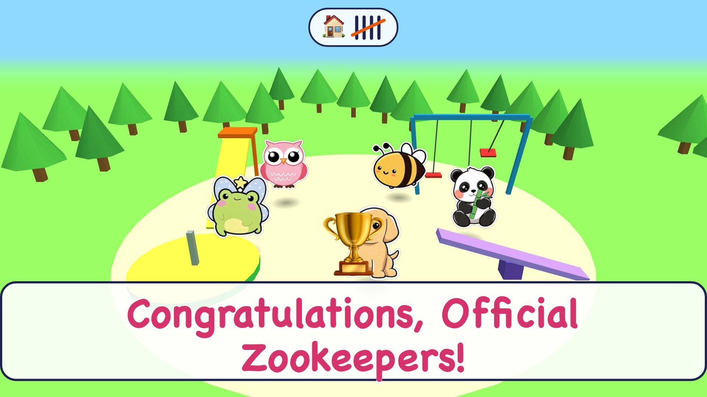

## What the kids see

| | |
|---|---|
| 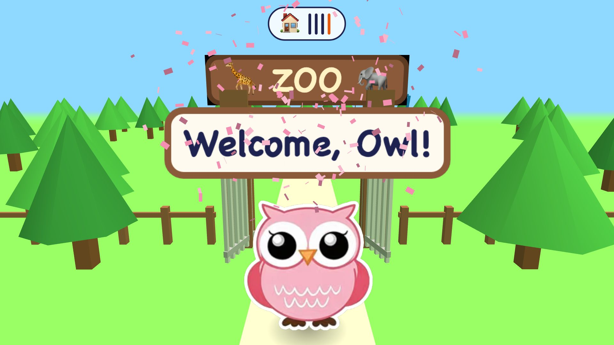 | 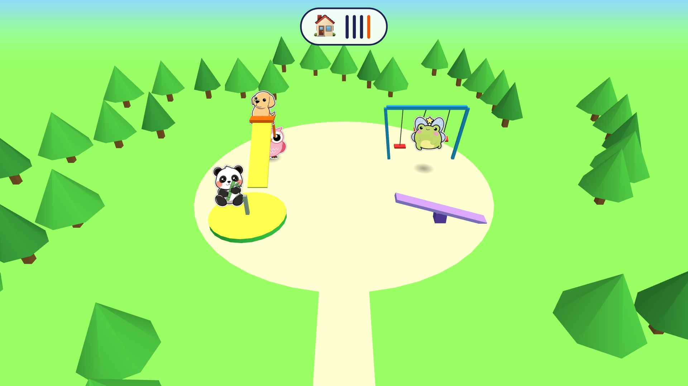 |
| **Tap in.** Your own animal (a photo of *your* sticker) arrives at the gate with confetti in your badge's color. | **Play.** Everyone who's in plays on the slide, swings, seesaw and merry-go-round. Tally marks count who's here. |
| 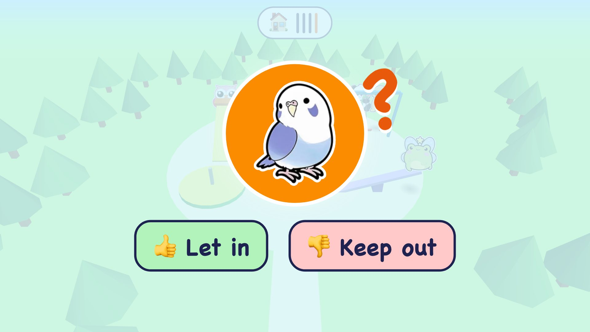 | 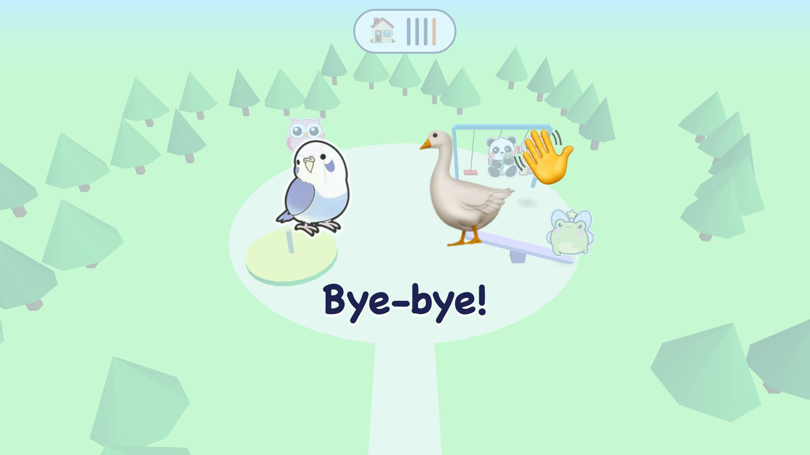 |
| **Trick badges.** Is that really the right animal and color? Thumbs up or down! | **Keep out?** The gatekeeper goose honks and waves it bye-bye. |
| 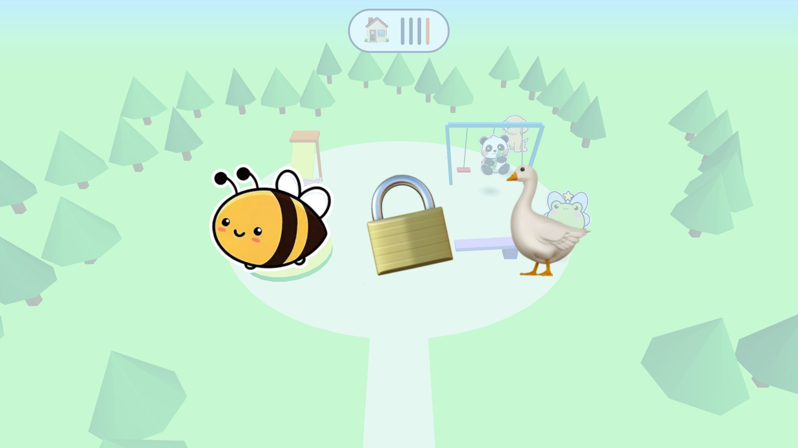 | 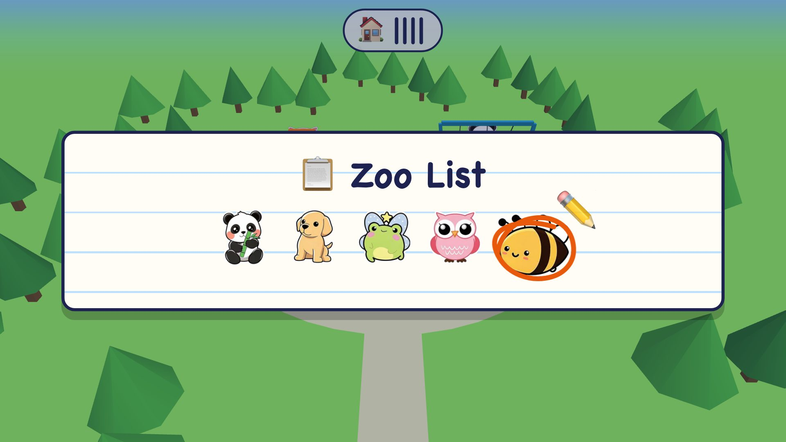 |
| **The golden badge** isn't on the list… the padlock pops on and the goose says no. | **Add it to the Zoo List**, tap again, and the party starts. |

Unknown badges get a gentle "Oops! Tap again 🔄" (no red, no buzzer). There's also a
**Secret Number** scene that reveals the number hidden inside a badge, **The List** that shows
the computer looking it up, and a **Who has the 🐼?** game.

| | | |
|---|---|---|
| 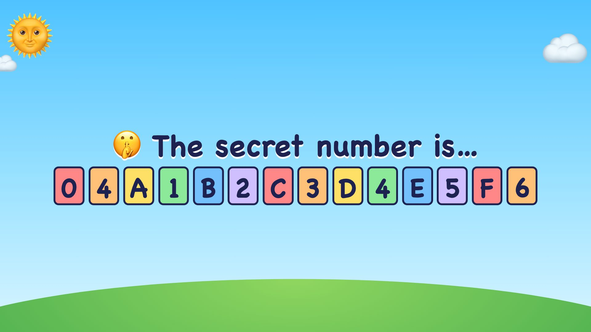 | 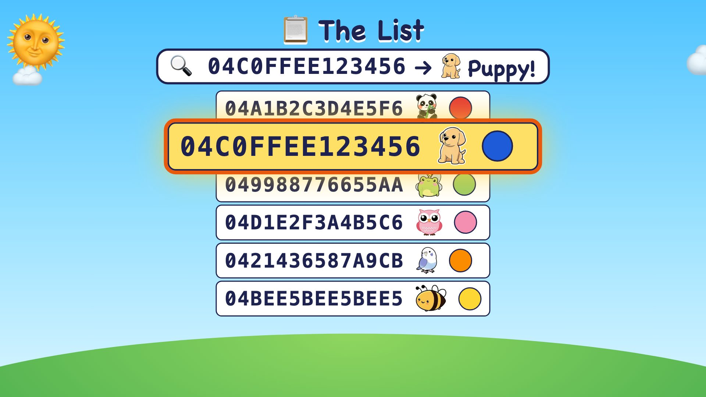 | 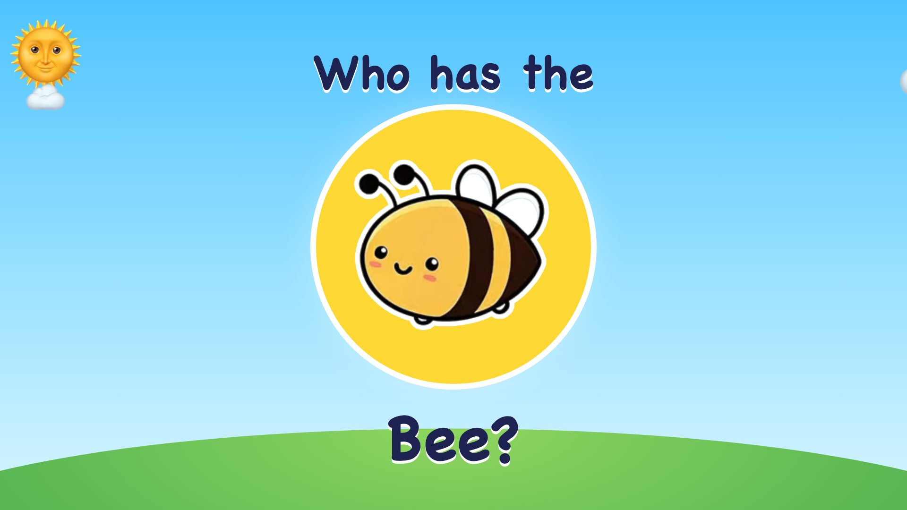 |

## What the presenter uses

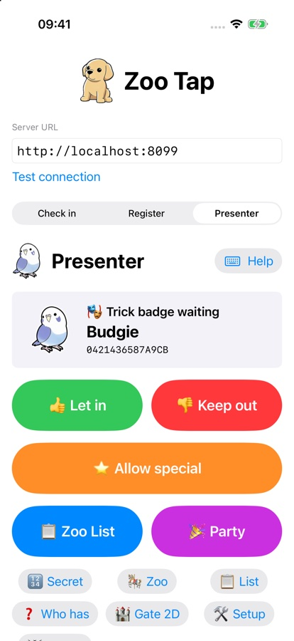

- **A Mac** runs everything offline and drives the projector.
- **A USB badge reader** and/or **an iPhone** read the badges.
- **Zookeeper**, the iPhone app, registers badges (it photographs each sticker and cuts it out
  automatically) and is your **remote**: Let in / Keep out, Allow golden, Zoo List, Party,
  scene switching, and a Help sheet with every Mac shortcut as a fallback.

Everything runs locally: the Mac joins the iPhone's hotspot, and no internet is needed.

<br clear="right">

## Quick start

```sh
cd server
cargo run --release -- --cards ~/cards.json
```

Open **http://localhost:8080/** in Chrome, click **Click to start**, and press **⌥3** for the zoo.
No hardware yet? Press **⌥T** and type a badge ID, or `curl` a tap; see the
[presenter guide](docs/presenter-guide.md#try-it-without-hardware).

## Learn more

- 🎤 **[Presenter guide](docs/presenter-guide.md)**: lesson flow, every scene, keyboard shortcuts,
  the phone remote, and a pre-class checklist.
- 🛠️ **[Setup guide](docs/setup.md)**: running the server, the iPhone hotspot, installing Zookeeper,
  and registering badges with sticker photos.
- 👩‍💻 **[Developer guide](docs/developer.md)**: how it's built, the HTTP API, badge ID matching,
  tests, and adding your own scene.
- 📐 Design notes: [zoo playground](docs/superpowers/specs/2026-11-17-zoo-playground-design.md),
  [gatekeeping](docs/superpowers/specs/2026-11-18-zoo-gatekeeping-design.md).
