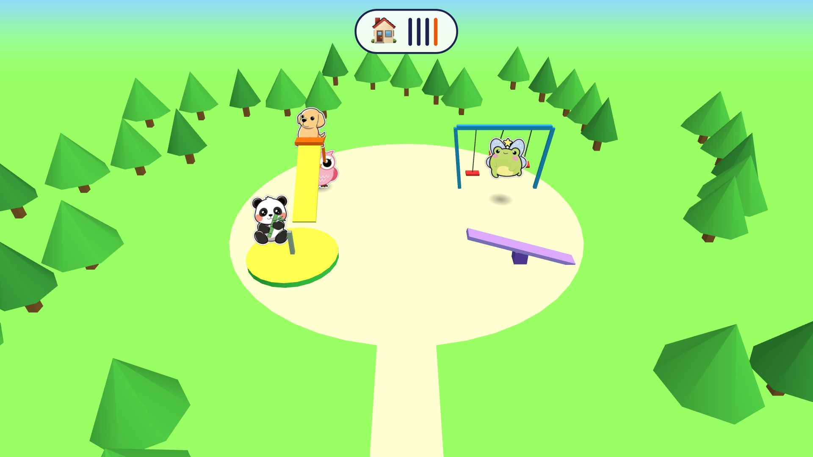
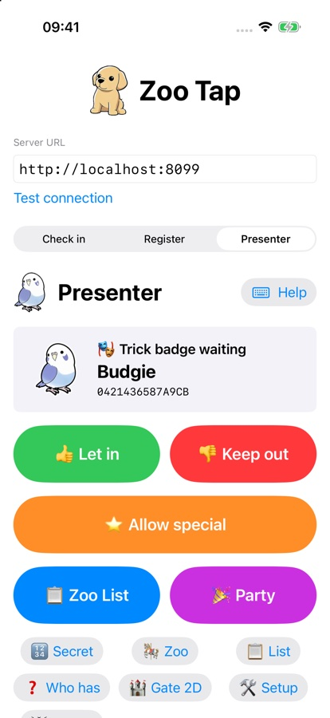

# 🎤 Presenter guide

[← Back to the README](../README.md) · [Setup guide](setup.md) · [Developer guide](developer.md)

## Lesson flow

The full script, step by step, is the **[run of show](run-of-show.md)**. In short:

1. Intro, then Charlotte hands out the mystery badges.
2. **Everyone scans in** (**⌥3**) with the phone: animals walk in, the tally grows.
3. "How did the computer know it was YOUR animal?"
4. **Mystery badge #1** (animal only) does nothing; **mystery badge #2** (special sticker only)
   brings in a cat. The computer reads the special sticker, not the animal.
5. **Trick badge votes:** thumbs up or down for each.
6. **Golden badge finale:** turned away → you allow it → it walks in → **party!**
7. Kids decorate their badges while you take questions.

## The projector page

Open `http://localhost:8080/` in Chrome on the Mac and click **Click to start** (it unlocks sound
and goes fullscreen). The USB reader types into this window, and the page keeps focus by itself.
Kid scenes use a bright sky theme, the real sticker photos (emoji when a badge has no photo yet),
and sound effects. There is no spoken voice. Setup and Debug stay dark.

### Keyboard shortcuts

Shortcuts always use **Option (⌥)** so the reader can never trigger them.

| Key | Action |
|-----|--------|
| ⌥1 | Setup (presenter only) |
| ⌥2 | Secret Number |
| ⌥3 | Zoo playground, 3D (main scene) |
| ⌥4 | The List |
| ⌥5 | Who has the ___? |
| ⌥6 | Zoo Gate, 2D (backup if 3D misbehaves) |
| ⌥0 | Debug (presenter only) |
| ⌥L | Show / hide the Zoo List |
| ⌥Y | 👍 Let in (trick vote) |
| ⌥N | 👎 Keep out (trick vote) |
| ⌥A | ⭐ Allow the golden badge |
| ⌥S | Start the party (zoo scenes) / next animal (Who has) |
| ⌥R ⌥R | Reset the zoo (press twice within 3 s) |
| ⌥P | Presenter panel (also: click the invisible top-right corner) |
| ⌥F | Fullscreen |
| ⌥M | Mute all sound |
| ⌥T | Typing test mode: accept hand-typed hex (normally ignored as too slow) |

`#setup`, `#secret`, `#zoo`, `#list`, `#who`, `#gate` and `#debug` in the URL open that scene
directly.

## Badge roles

Set a role when registering a badge, in Zookeeper's **Register** tab or in **⌥1 Setup**.

- **Normal:** walks into the zoo and adds a tally mark.
- **🎭 Trick:** the stored animal or color is deliberately wrong (photograph a spare sticker for
  it, or pick a different color). The class votes on it.
- **⭐ Golden:** any animal you choose. It's denied until you allow it, and its entry starts the
  party.
- **💤 Not here today:** set from the phone for badges you're holding back. Those animals stay out
  of the zoo and of Who has the ___?. If that badge is tapped later, it checks in as normal.

Roles only matter in the zoo scenes. Everywhere else, trick and golden badges act like any other
card.

## The scenes

### 🎠 Zoo playground (⌥3, the main scene)



- **Arrival:** a tap swoops the camera to the ZOO gate, where that badge's sticker waits. The gate
  opens with confetti in its cardstock color, the sticker hops into the playground, its friends
  bounce with hearts, and it joins the slide, swings, seesaw, merry-go-round or grass. Several taps
  in a row queue up and arrive faster.
- **Tally:** marks at the top, in groups of five. One mark for each normal entry, each trick badge
  voted in, and the golden badge.
- **Calm while you talk:** after 15 seconds with no taps, everyone strolls to a spot on the grass
  and sits still, and the goose stops nodding. The next tap or command wakes the zoo up.
- **Unknown badge:** a blank "?" card hops up to the gate and the goose tilts its head, then a
  small "Oops! Tap again 🔄" with a soft boop. Nobody goes in.
- **Tapping again when already inside:** that animal runs to the gate and waves hello through the
  bars.
- **🪿 The gatekeeper goose** stands beside the gate the whole time, nodding while it keeps watch.
- **🎭 Trick badge:** its sticker walks up to the gate and the goose tilts its head at it. Then the
  vote card shows its stored animal and color with a bouncing "?" and 👍 Let in / 👎 Keep out. Kids
  vote with thumbs; you press **⌥Y** / **⌥N** (or use the phone). The vote needs a second on screen
  before a decision counts, so a double press can't skip the next vote, and a press before the card
  shows is ignored.
  - **Let in:** it walks in with confetti and adds a mark.
  - **Keep out:** the goose honks and waves a wing, and the sticker hops away under a "Bye-bye!"
    sign. Kept out isn't final: that badge's next tap gets a new vote.
  - Taps that arrive during a vote wait their turn.
- **⭐ Golden badge:**
  - At first it's denied: it peeks at the gate, a big gold padlock pops onto the doors and wobbles,
    and the goose honks and shakes its head.
  - Press **⌥A** (Allow): the goose holds up its clipboard at the gate, then the **Zoo List** pops
    up, and a pencil scribbles the golden badge in. The list shows every badge: ✅ in the zoo,
    an empty box for not in yet, ❌ not on the list (the golden badge before it's allowed, a trick voted
    out), and 💤 not here today. (If an animal is still
    walking in, the list waits for it.) **⌥L** shows the list the same way.
  - The golden badge's next tap walks it in, adds a mark, and **starts the party**. **⌥S** starts
    the party any time.
- **🎉 Party:** balloons float up, everyone dances in a ring with the goose in the middle (the
  golden badge animal puts on a 🤿 snorkel and bounces around), then
  "Congratulations!" appears.
- **Saved:** check-ins survive a page reload. **⌥R ⌥R**, or Reset on the phone, clears everything
  and denies the golden badge again.

### 🏰 Zoo Gate (⌥6, backup)

The earlier flat version, with the same rules, tally and check-ins (its goose and padlock are flat
pictures). Switch to it if the 3D scene stutters on the classroom computer.

### 🔢 Secret Number (⌥2)

Any tap, known or not, reveals the raw ID digit by digit on rainbow tiles, then a chime.

### 📋 The List (⌥4)

Every registered card with its secret number, animal and color swatch. A tap shows the tapped
number, visibly scans down the list, then highlights the matching row. 💤 badges are faded.
Unknown badges get the gentle retry.

Secret Number shows an ID exactly as the device sent it. If the USB reader sends a shortened or
reversed form, it won't look like the List's number, but The List still finds the right row.

### ❓ Who has the ___? (⌥5)

Shows one animal. The right badge gets confetti and "Yes!", and the next animal comes up after 4
seconds. A wrong badge gets a silly buzzer and "Nope! That's the Lion". An unknown badge gets the
gentle retry. **⌥S** skips. Every present card is asked once before any repeats.

### 🛠️ Setup (⌥1) and 🐞 Debug (⌥0)

- **Setup:** tap a badge. Unknown → pick an animal, cardstock color and role → Save. Known →
  ✏️ Change or 🗑️ Delete. Click an animal in the bottom strip to edit it. Duplicate badges get a
  loud red warning.
- **Debug:** a live log of every tap (source, raw and matched ID, card) and ignored reader input.

The **presenter panel** (**⌥P**) has the zoo buttons, **💤 Everyone's here** (clears every 💤), and
the last unknown badge's ID.

## Deciding while you scan (Zookeeper → Check in)

When you scan a 🎭 trick or ⭐ golden badge on **Check in**, scanning pauses and the screen shows
that badge with big buttons: **👍 Let in / 👎 Keep out** for a trick, **👍 Let in / Not yet** for the
golden badge. Tap one and scanning starts again by itself. You can tap as soon as the buttons
appear: the zoo applies it once the class has seen the vote card.

- **Fix the picture:** a trick badge with a **real photo** (added in Register) offers
  **🔧 Fix the picture** after you keep it out. One tap swaps the real photo in on the projector;
  scan it again for a new vote. **Reset** puts the trick photo back.
- **Golden badge:** after it's turned away, the Zoo List pops up with it ❌ not on the list.
  **Let in** writes it on; the phone then says "✅ On the list! Scan … again", and that scan walks
  it in and starts the party.

## The phone remote (Zookeeper → Presenter)



- **Buttons:** 👍 Let in / 👎 Keep out, ⭐ Allow golden, 📋 Zoo List, 🎉 Party, every scene, and
  🔄 Reset (asks to confirm).
- **Waiting card:** the trick or golden badge waiting for you (sticker, name and raw ID), and the
  last unknown badge's ID.
- **Help:** lists every Mac shortcut, for when the phone can't reach the Mac.

Every button does exactly what its Mac shortcut does.

<br clear="right">

## Try it without hardware

```sh
cd server && cargo run -- --cards /tmp/cards.json &
curl -X PUT localhost:8080/api/cards -H 'content-type: application/json' \
  -d '[{"canonical_id":"04A1B2C3D4E5F6","emoji":"🐧","label":"Penguin","color":{"hex":"#1E5BD8","name":"Blue"}}]'
curl localhost:8080/tap -H 'content-type: application/json' -d '{"id":"04A1B2C3D4E5F6","source":"phone"}'
curl localhost:8080/tap -H 'content-type: application/json' -d '{"id":"DEADBEEF","source":"reader"}'   # unknown
```

On the page, press **⌥T** (typing test mode), type `c3b2a104` and press Enter. That's the same as
the reader sending the penguin's ID shortened and reversed. Press ⌥T again to turn it off. Watch
everything in **⌥0 Debug**.

## Pre-class checklist

**The night before**
- [ ] `cargo build --release`, and keep `server/target/release/badge-server` somewhere safe.
- [ ] Start it with `--cards ~/cards.json` (photos are saved in `~/images/`).
- [ ] Zookeeper is on the iPhone (reinstall from Xcode if it won't open).
- [ ] Zookeeper → **Register**: scan each badge, snap its sticker, name it, and pick its cardstock
      color and role. Three 🎭 trick badges (photograph a spare sticker for them) and one ⭐ golden.
- [ ] Tap every badge on the **USB reader** with ⌥1 Setup open. For any that show the picker
      instead of the card: tap it on the phone, then on the reader within 5 s, to link them.
- [ ] Back up `cards.json` and the `images/` folder.
- [ ] Rehearse from the phone's **Presenter** tab:
  - ⌥2, then ⌥3, and a few check-ins.
  - An unknown sticker (gentle retry).
  - A trick vote each way.
  - The golden badge (denied → Allow → party).
  - Finish with **Reset**.
- [ ] Make sure ⌥3 runs smoothly on the Mac. If it doesn't, use ⌥6, the 2D backup.

If something odd happens during class, the full story (server, projector page and phone) is in
`~/badge-server.log`.

**In the classroom**
- [ ] Mac on the iPhone hotspot; server running with `--cards ~/cards.json`.
- [ ] Chrome → `http://localhost:8080/#zoo`, **Click to start**, fullscreen (⌥F).
- [ ] Projector volume up; ⌥P → Chime plays.
- [ ] ⌥P shows 🟢 Connected and the right card count. Press **💤 Everyone's here** if any 💤 are
      left over from last time.
- [ ] Zookeeper → **Register**: scan each badge you're holding back → **💤 Not here today**.
- [ ] Zookeeper → **Check in**: server URL set, it shows 🟢 Connected, Start Scanning. One test
      tap shows in ⌥0 Debug as 📱 phone.
- [ ] Reader: one test tap shows as ⌨️ reader. Typing test mode is **off**.
- [ ] **Reset** (phone, or ⌥R twice) right before the kids start.
- [ ] A bare NFC sticker for the Secret Number opening.
